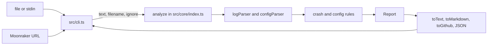

# klipper-doctor: how it is built

A TypeScript package, ESM, built to a committed `dist/` and published to npm as one library and one CLI. It has no runtime dependencies. The engine in `src/core/` is a pure function from text to a report, and the CLI in `src/cli.ts` is a thin shell that reads input, calls the engine and prints. <!-- src: package.json#type, package.json#bin, package.json#devDependencies, src/core/index.ts:384-398 -->

## Components

- **CLI**, `src/cli.ts`: parses arguments, loads each input (file, `-` for stdin, or a Moonraker URL), calls `analyze`, renders the chosen format and sets the exit code. It is the only module that touches the filesystem, the environment or the network. <!-- src: src/cli.ts:36-93, src/cli.ts:251-301 -->
- **Option table**, `src/options.ts`, and **completions**, `src/completions.ts`: the options are described once, and `--help` and the bash, zsh and fish completion scripts are generated from that table. <!-- src: src/options.ts:1-2, src/completions.ts:101-104, src/cli.ts:251-257 -->
- **Engine entry**, `src/core/index.ts`: `analyze(text, opts)` never throws, and `rulesMetadata()` lists every rule. `src/index.ts` re-exports it as the library entry named by `main`, `types` and `exports` in `package.json`. <!-- src: src/core/index.ts:384-420, src/index.ts, package.json#exports -->
- **Log parser**, `src/core/logParser.ts`: splits lines (LF, CRLF, lone CR), decides whether text looks like a `klippy.log`, and cuts it into sessions, one per Klipper start, each holding its config dump, MCU versions, shutdown lines and the other notable lines. <!-- src: src/core/logParser.ts:62-134, src/core/logParser.ts:31-49 -->
- **Config parser**, `src/core/configParser.ts`: parses config text the way Klipper's `configfile.py` does (lowercased option names, last value wins, indent-based continuation, `[include]` lines, the SAVE_CONFIG block). <!-- src: src/core/configParser.ts:1-12 -->
- **Cause finder**, `src/core/cause.ts`: picks the first shutdown reason in a session and limits what rules may read to the lines before that shutdown plus the reason Klipper logged. <!-- src: src/core/cause.ts:41-70 -->
- **Crash rules**, `src/core/rules/crash/` (`mcu.ts`, `tmc.ts`, `heater.ts`, `gcode.ts`, `homing.ts`, `extruder.ts`, `config.ts`, `commandError.ts`, `fallback.ts`) and **config rules**, `src/core/rules/config/` (`structure.ts`, `removed.ts`, `required.ts`, `tuning.ts`, `hardware.ts`). Each folder's `index.ts` lists the rules that run. `commandErrorTable.ts` is generated from the Klipper source. <!-- src: src/core/rules/crash/index.ts:27-60, src/core/rules/config/index.ts:17-35, src/core/rules/crash/commandErrorTable.ts:1-3 -->
- **Suppression**, `src/core/suppress.ts`: drops config findings named by `--ignore` or by a `# klipper-doctor: ignore <rule-id>` comment. <!-- src: src/core/suppress.ts:3-12, src/core/suppress.ts:34-57 -->
- **Report**, `src/core/report.ts`: renders a report as text, Markdown or GitHub workflow commands; the JSON form is the report object itself. <!-- src: src/core/report.ts:56-148, src/cli.ts:283-288 -->
- **Shipped build**: `dist/` is committed, and the package ships only `dist`, `README.md` and `LICENSE`. <!-- src: package.json#files, .github/workflows/ci.yml:38-39 -->
- **Integrations that run the built CLI**: the composite GitHub Action in `action.yml` runs `dist/cli.js` with `--format github`, and `.pre-commit-hooks.yaml` defines a pre-commit hook for `.cfg` files. <!-- src: action.yml:14-26, .pre-commit-hooks.yaml:10-18 -->
- **Dev scripts**, `scripts/`: rule table generator, command-error table generator, fixture builder, sample-config checker, benchmark, asset renderer, release planner, version sync. Tests are in `test/*.test.mjs` over fixtures in `test/fixtures/`. <!-- src: package.json#scripts, scripts/release.mjs:1-10 -->
- **GitHub workflows**: `ci.yml` (typecheck, tests, `dist` and rule table checks, and the Action on a clean and a broken config), `publish.yml` (npm publish and GitHub Release), `upkeep.yml` (weekly link check and dossier-scribe drift check), `dependabot-automerge.yml`. <!-- src: .github/workflows/ci.yml:1-60, .github/workflows/publish.yml:20-24, .github/workflows/upkeep.yml:1-5, .github/workflows/dependabot-automerge.yml:8-23 -->

## Data flow

- The CLI parses arguments. With no input it reads `~/printer_data/logs/klippy.log` if that file exists, and otherwise prints the usage and exits 2. <!-- src: src/cli.ts:36-93, src/cli.ts:266-273 -->
- Each input is loaded: a path through `readFileSync`, `-` from stdin, and an `http(s)` URL through the Moonraker fetch described under External services. <!-- src: src/cli.ts:207-209, src/cli.ts:231-244 -->
- `analyze` cleans the text (byte order mark, NUL bytes), splits it into lines, and returns a single `unusable-input` finding for empty input, Moonraker's own log, or a binary file. <!-- src: src/core/index.ts:215-225, src/core/index.ts:247-283 -->
- Text that is not recognised as a klippy log and whose name does not end in `.log` is treated as a hand-written `printer.cfg`: config rules only, with inline suppressions applied. <!-- src: src/core/index.ts:285-317 -->
- Otherwise the log is parsed into sessions and the last one is analysed. Its config dump goes through the config rules, a note is added when an MCU runs a different build from the host, and the crash rules run over the cause's lines. <!-- src: src/core/index.ts:319-350 -->
- When no crash rule gives an error, the engine reports an unknown shutdown reason if the session shows a failure, and otherwise `no-failure-found`, which names the latest earlier session that failed. <!-- src: src/core/index.ts:351-362, src/core/index.ts:165-190 -->
- A finding carries an id, severity, title, detail, fix, an optional Klipper docs link and evidence lines with line numbers. Title, detail and evidence text are clipped to 300, 4000 and 2000 characters. <!-- src: src/core/types.ts:8-19, src/core/index.ts:54-66 -->
- The CLI renders the report in the chosen format (`--config-only` empties the crash list first) and exits 1 when any finding is an error, 0 otherwise. Usage and read errors exit 2. <!-- src: src/cli.ts:277-301, src/cli.ts:18-23 -->

## Storage

Nothing is stored. The only writes are to stdout and stderr, and the source reads files only through `readFileSync` on the named inputs and the default log path. <!-- src: src/cli.ts:207-209, src/cli.ts:231-244, src/cli.ts:266-273 -->

## Auth

No login and no accounts. The only credential is an optional Moonraker API key, read from an environment variable and sent as `X-Api-Key`. It is never printed, and a redirect is refused rather than followed so the key cannot be sent to another address. <!-- src: src/cli.ts:104-111, src/cli.ts:155-160, src/cli.ts:183-190 -->

## External services

- **Moonraker** (the printer's API), only when a URL is given: `GET /server/files/klippy.log`, then `GET /server/files/logs/klippy.log` when the first answers 404, on the host and path given. Each request has a timeout (default 30 seconds, `--timeout`). Env var: `MOONRAKER_API_KEY`, or the variable named by `--api-key=NAME`. <!-- src: src/cli.ts:13-16, src/cli.ts:137-166, src/options.ts:6, src/options.ts:24-25 -->
- No other network call is made at runtime. The Klipper docs and source links in findings are text for the reader and are not fetched. <!-- src: src/cli.ts:159, src/core/rules/types.ts:64-65 -->
- At build and release time only: the npm registry and GitHub, through `publish.yml`, which uses the `NPM_TOKEN` secret when set and otherwise npm trusted publishing. <!-- src: .github/workflows/publish.yml:1-18, .github/workflows/publish.yml:70-83 -->

## Unverified

- The same engine runs in the browser at hotend.app/klipper-doctor. That page lives in another repo, so how it vendors this engine could not be checked here. <!-- src: README.md -->
- The Moonraker routes and their 404 behaviour are as the code comments describe them. Moonraker's docs were not checked for this file.
